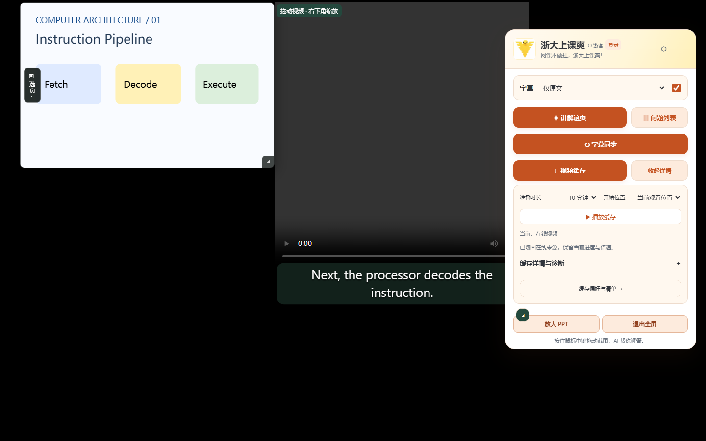

# 浙大上课爽

**网课不硬扛，浙大上课爽！**

给智云课堂回放加上同步字幕、PPT 讲解和本机缓存。打开课堂就能用；配置藏在设置里，需要时再调。

**[点击安装 / 更新油猴脚本](https://raw.githubusercontent.com/FILAgiao/zhiyun-subtitles/main/zhiyun-subtitles.user.js)** · [品牌、备选标语与功能清单](产品与品牌说明.md) · [问题反馈](https://github.com/FILAgiao/zhiyun-subtitles/issues)



## 安装与更新

1. 安装并启用 Tampermonkey，在浏览器扩展设置中允许用户脚本运行。
2. 点击上面的安装链接，按油猴提示安装。旧用户请核对更新后只启用一份脚本，避免旧名称脚本同时运行。
3. 刷新智云课堂回放，打开网站右侧“语音识别”以加载字幕。油猴脚本版本应为 **0.19.6**。
4. 字幕、PPT、语音同步和缓存无需登录；双语翻译和 AI 讲解需要在右上角账号页登录，账号目前人工开通。

脚本包含 `@updateURL` / `@downloadURL`：油猴读取轻量的 `.meta.js` 检查版本，再下载完整 `.user.js`。首次安装后按照油猴自己的检查周期更新，也可以在油猴管理面板手动检查。详见 [Tampermonkey 官方说明](https://www.tampermonkey.net/documentation.php?locale=zh_&q=update_url)。

## 当前版本使用提示

按住中键，在当前页面原位置拖框、松开选定，然后点“发送提问”。只发送框内图片，不发送整页。取消不请求模型。

点击 AI 面板“开启连续截图”，首次选择**当前标签页**后，本页中键框选可复用共享流，减少重复授权；右上角显示本地共享状态和“停止共享”。关闭页面或停止共享会结束，下一次需要重新授权。单次截图仍会立即结束共享。油猴无法绕过浏览器的首次截图授权。

“新对话”会清空旧截图和 PPT 上下文，即使翻页记忆开启，简单文字问候也不会自动带图。需要图片时重新截图、粘贴或点击“讲解本页”。模型端使用 SSE 流式生成，油猴用短 HTTP 请求持续读取增量文字；无正文等待超过 45 秒会停止并给出提示，可自行重试。

## 四件事，直接上手

| 想做什么 | 操作 |
| --- | --- |
| 正常看课 | 主面板选择原文或双语；空格播放/暂停，左右前后 10 秒 |
| 看清内容 | “看 PPT”“字幕列表”“课堂全屏”；PPT 可拖动和缩放 |
| 看不懂这页 | “讲解这页”，或“截图问”；支持中键页面框选、连续追问、费曼/专业/复习模式 |
| 提前备好视频 | 展开“视频缓存”，准备 10 / 20 分钟；就绪后默认自动接续本机播放 |

画面布局、时间微调、术语表、模型和连接信息集中在分类设置。输入文字时不会抢播放快捷键；PPT 聚焦时左右键翻页。AI 回答之后可保存本地知识卡。

## 0.17.0 改了什么

- **更清楚的界面**：统一品牌与标语；主要操作围绕字幕、讲解、截图。语音同步在右上角折叠显示，布局细节在设置，缓存按需展开。
- **播放与全屏**：缓存使用原生视频控制条，隐藏已适配的网站重复控制条；课堂全屏保留字幕、PPT 和可打开的字幕列表。
- **缓存与 Chrome**：存储改为纯数据定位信息，避开本机 Chrome 153 读取 IndexedDB 文件系统句柄时的进程崩溃。旧缓存保留，恢复方式见下方。
- **缓存反馈与删除**：显示读取索引、准备片段、后台补齐等阶段及实际进度；停止写入后再删除文件，避免看似删除却仍在写入。
- **翻译更有上下文**：术语增强模式结合每侧默认 12 句、课程背景及术语表，仍只输出当前句；可切回逐句省流。选择双语才开始付费模型请求。
- **统一时间**：PPT 和字幕共用分段同步点，处理不同课堂位置的漂移。定时校准默认关闭，手动微调立即接管并取消自动任务。
- **AI 理解课程**：当前 PPT 讲解、框选/粘贴截图、多轮文字对话、解释模式与知识卡；翻页上下文可选，翻页本身不请求模型。

## 缓存与旧数据

缓存支持已授权、可访问的普通未加密 MP4；完整缓存也支持 WebM。分段缓存使用 MP4 索引确定可播放时间，不用文件百分比推算。10 / 20 分钟指课程时长，不是承诺的下载等待时间。

新版本不把文件夹句柄写进 IndexedDB。默认浏览器存储按名称重新定位；自选文件夹在刷新后需要重新选择。旧数据库不自动删除；Chrome 153 不直接读取旧记录以避免崩溃。设置中的旧缓存恢复入口说明可恢复范围，无法确定归属的旧分段保留，不自动拼接或覆盖。

保留课程标签页才能继续下载；清理浏览器站点数据可能删除默认缓存。已保存视频不等于整个课堂网站可离线打开。HLS/DASH、加密视频或浏览器不支持的编码不在当前适配范围。

## AI、凭证与费用

翻译与讲解共用用户保存在油猴中的豆包 Key，默认讲解/增强翻译模型为 `doubao-seed-2-1-lite-260915`，讲解模型可在设置中修改。示例中的 `$ARK_API_KEY` 是环境变量占位符，项目没有附带实际密钥。

AI 只在提问时发送相关文本/图片，联网搜索入口暂时隐藏，留待后续开发；知识卡仅在本机生成，不自动上传。定时语音校准使用独立语音服务凭证。当前没有实时语音对话、充值或支付；方案见 [UX-DESIGN.md](UX-DESIGN.md)，接口与数据范围见 [AI-LEARNING.md](AI-LEARNING.md)。

## 开发与验证

```sh
npm ci
npm run build
npm test
npm run test:ui
npm run test:cache
npm run test:stream
npm run test:storage
npm run test:release
```

本次验证通过：49 项单元测试、7 套界面回归、2 套缓存流程回归、Chrome 153 的真实缓存刷新/解码/删除、Edge 的旧句柄迁移及事务回滚，以及真实 MP4 头部/尾部索引和分段播放。

浏览器回归可通过 `PLAYWRIGHT_EXECUTABLE_PATH` 指定本机 Chrome / Edge / Chromium。旧句柄迁移测试默认使用本机 Edge，也可设置 `STORAGE_MIGRATION_BROWSER` 指向能够安全读取旧句柄的浏览器。真实媒体测试先运行 `npm run test:media` 生成测试视频。缓存引擎、界面、播放器交互和 AI 模块在构建时内联进脚本，安装后不依赖远程模块加载。

测试使用模拟课堂、自生成 MP4 和模拟云端响应；没有访问用户登录课堂或消费真实云端 API 额度。测试结果不代表所有课堂来源和长期浏览器运行均已验收。

求是蓝和小黄鹰用于个人学习工具的视觉表达，**非浙江大学官方产品**。历史记录见 [CHANGELOG.md](CHANGELOG.md)，MP4Box.js 许可见 [THIRD_PARTY_NOTICES.md](THIRD_PARTY_NOTICES.md)。

## 统一后端代理（最小版本）

新增服务账号登录、额度查询，以及翻译／AI 讲解／语音校准的服务器代理。配置后端后，浏览器只使用用户会话，供应商 Key 由服务器环境保存。发布时用 GATEWAY_ORIGIN 固定服务域名。多 APP 权限、额度口径和部署方法见 [backend/README.md](backend/README.md)。当前仍是油猴脚本，尚未转换为 Chrome 插件；服务器已连接并部署到 https://47.77.182.216.sslip.io/gateway，豆包凭证已配置，真实翻译、AI 调用及语音识别验证通过。

### 油猴服务账号与网页后台测试

0.19.1 已部署测试入口和截图、额度说明见 [backend/TESTING.md](backend/TESTING.md)。后台支持用户名/邮箱登录、用户管理、调用记录和会话活动；豆包密钥仅保存在服务器。


## 0.19.1 更新

进入插件时，右上角会显示登录状态：游客可用原文字幕、语音同步和本机缓存；登录后解锁 AI 对话、PPT 讲解、截图问答和中英翻译。没有账号请联系管理员人工开通，自助注册暂未开放。账号页不再提供服务地址输入框或后台入口。

展开“语音同步”即可听 12 秒校准或用 ±0.5 秒微调；进度与完成结果就在面板中。字幕列表时间会同步调整，点击后跳转至对应的视频时间。中键直接开始截图，浏览器首次会要求选择当前标签页；页面与 PPT 布局保持原样，框选后点击发送才上传。AI 使用 HTTP SSE 流式回复；旧服务器仍可返回 JSON，界面会显示等待秒数和停止按钮。

**上线状态（2026-10-09）：** 0.19.1 脚本与后端已部署，旧代码和数据库已备份。公开安装包与自动更新元数据均与本地构建一致。未登录的 12 秒合成语音成功识别；经用户授权的测试截图获得逐段文字回复，实际用量正常返回。验收记录见 [backend/acceptance-0191.json](backend/acceptance-0191.json)。[安装新版脚本](https://47.77.182.216.sslip.io/gateway/install.user.js)，然后刷新课堂页面；只启用一份脚本。

**最新上线（2026-10-10）：** 0.19.2 已部署并通过公网安装包一致性与真实两轮流式对话验收。[直接更新油猴](https://47.77.182.216.sslip.io/gateway/install.user.js)，更新后刷新课堂，只启用一份脚本。具体修复和验证见 [CHANGELOG](CHANGELOG.md) 与 [0.19.2 验收](backend/acceptance-0192.json)。

**紧急修复（2026-10-10）：** 0.19.3 已部署。针对“已连接但一直无文字”，插件不再依赖油猴的 ReadableStream，通过短请求获取同一模型任务的增量；轮询不增加模型次数。公网 hi 和禁用 GM 流的真实浏览器两轮对话已通过。[直接更新油猴](https://47.77.182.216.sslip.io/gateway/install.user.js)，更新后刷新课堂，确认版本 **0.19.3**。[验收结果](backend/acceptance-0193.json)。

**最新修复（2026-10-10）：** 0.19.4 已部署。截图中的“联网搜索未开通”来自旧设置请求搜索工具，原后端会直接拒绝整次对话。现在未开放搜索时自动按普通对话回答并提示，旧版本也兼容；新版根据服务能力禁用搜索选项。公网带旧搜索参数发送 hi，6.78 秒完成、只调用一次模型。[直接更新油猴](https://47.77.182.216.sslip.io/gateway/install.user.js)，更新后刷新课堂。[验收结果](backend/acceptance-0194.json)。

**界面优化（0.19.5）：** 回答使用 Markdown 排版，未开通搜索的提示和账号入口显示在回答底部。对话可收起后继续，本标签页按课程保存文字记录和未发送草稿，刷新可恢复；截图附件不保存。当前联网搜索仍由管理员开放，没有自助支付开通页面。

**阅读与提问优化（0.19.6）：** 纯文字追问不再重传截图，点击“讲解本页”或重新截图/粘贴才发送图片。正文调到 16px、面板适度加宽，公式库和字体内嵌加载。费曼模式默认“一句核心＋一个小例子”，追问才展开。联网搜索入口和开通提示均隐藏，旧开关关闭。
