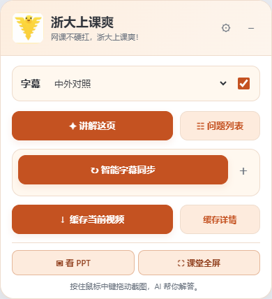
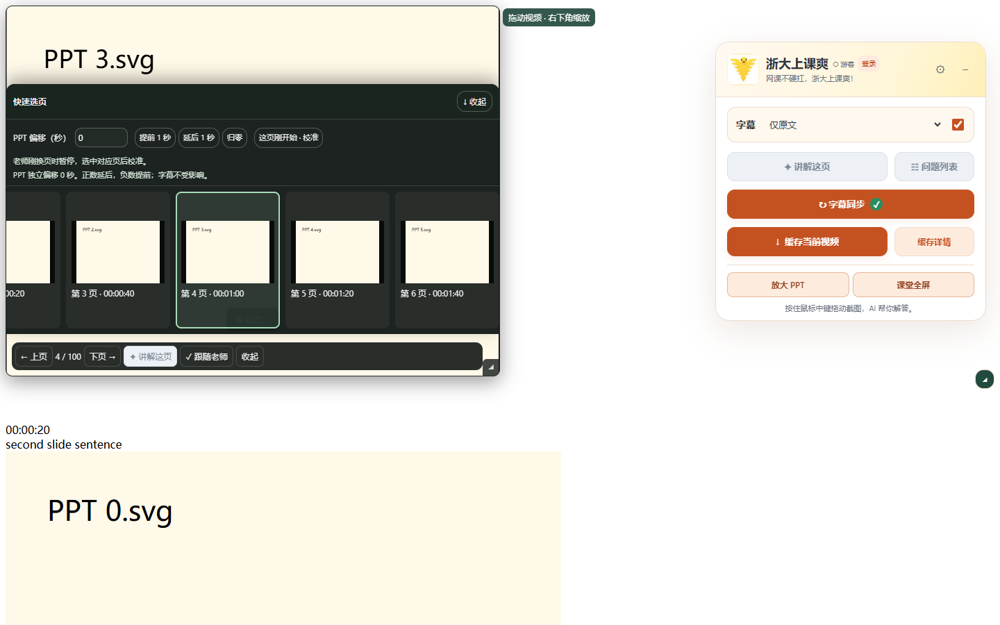

# 浙大上课爽

**网课不硬扛，浙大上课爽！**

给智云课堂回放加上同步字幕、PPT 讲解和本机缓存，也支持在普通网页选中文字或截图提问。打开课堂就能用；配置藏在设置里，需要时再调。

**[点击安装 / 更新油猴脚本](https://47.77.182.216.sslip.io/gateway/install.user.js)** · [品牌、备选标语与功能清单](产品与品牌说明.md) · [问题反馈](https://github.com/FILAgiao/zhiyun-subtitles/issues)



历史安装包和来源校验见 [版本归档](releases/README.md)，完整更新说明见 [CHANGELOG](CHANGELOG.md)。

**0.20.27 已上线**：恢复全屏字幕持续显示，修复选词 / 问答窗口定位和截图原位编辑。

**0.20.30 已上线**：普通网页入口改为「问此页（自动截图）｜AI 对话｜☰ 历史」紧凑胶囊，合并重复的继续对话按钮；完整备用安装文件为 `zhiyun-subtitles.user.js`。

## 0.20.38 修改记录（2026-10-13，本地修复，尚未上线）

- **原因**：0.20.31 将在线播放原有控制条隐藏并统一替换成浅色外置播放条，视觉突兀，违背用户希望使用网站在线播放进度条的要求。
- **行为变化**：在线播放恢复网站原有进度条及其事件处理，插件外置播放条仅在播放缓存时出现；全屏、PPT 布局及移动视频时保留网站控制条，只调整必要的位置和层级，不重绘原站皮肤。切回在线立即移除缓存控制条并恢复原有视频 controls 状态；保留 0.20.37 划词浮层修复。
- **验证结果**：67 项核心测试、安装包 / 元数据一致性校验及四套 Chrome 回归通过（classroom-fullscreen-ui、player-edge-ui、playback-ui、cache-playback-switch）；覆盖原站进度条真实鼠标拖动、课堂 / 网站按钮 / 视频 API 全屏、PPT 和移动视频、原生 controls 恢复，以及真实 src / source 视频连续三次缓存切回在线。使用隔离课堂测试页面，未在用户实际课程页面人工验收。
- **实际发布状态**：0.20.38 完整油猴、服务端安装脚本和更新元数据已构建；2026-10-13 通过公网下载核验完整脚本及元数据仍为 0.20.36。当前会话缺少发布所需 SSH 密码，尚未上传。完整备用安装文件为 [zhiyun-subtitles.user.js](zhiyun-subtitles.user.js)。

## 0.20.37 修改记录（2026-10-13，本地修复，尚未上线）

- **原因**：左键划词后切换到其他标签页，再切回来时“爽问一下”浮层仍残留。
- **行为变化**：页面隐藏或离开时立即关闭划词提问浮层；隐藏页面不创建新浮层。返回原标签页不会自动恢复旧弹窗，重新划词仍可提问；已打开的 AI 对话不受影响。监听随助手销毁清理，普通网页与课堂共用。
- **验证结果**：67 项核心测试、Chrome 划词生命周期专项（模拟页面可见性 / 离页事件）、网页入口交互和安装包元数据校验通过；验证隐藏关闭、返回不恢复、隐藏时不创建、重新划词、已有对话保留和销毁 / 重挂载。定位回归中的截图预览超时，修改前源码也在同一步超时；该整套回归未通过。
- **实际发布状态**：0.20.37 完整油猴和服务端脚本 / 元数据已构建，尚未上传：发布入口需要 SSH 密码，当前会话未提供。2026-10-13 核验公网完整脚本头部和更新元数据均仍为 0.20.36。完整备用安装文件为 [zhiyun-subtitles.user.js](zhiyun-subtitles.user.js)。

## 0.20.36 修改记录（2026-10-12，已上线）

- **原因**：插件右上角的共享会话浮条与浏览器自带的停止分享功能重复，并遮挡网页内容。
- **行为变化**：删除截图完成后的“本页截图会话已开启 / 停止共享”常驻浮条。截图等待时仍提供短暂的进度和取消入口；授权会话继续复用，关闭对话或取消批注不重新授权。共享由浏览器顶部的“停止分享”结束，离页或销毁仍释放资源。
- **验证结果**：4 套截图回归（轻量中键、共享会话、重复截图、AI 截图交互）、MV3 原生截图桥接回归和网页入口交互回归通过；验证连续截图 / 关闭对话 / 取消批注后不出现重复共享浮条，等待取消及浏览器停止 / 离页 / 销毁清理仍正常。安装包源码与元数据一致性校验通过，0.20.36 油猴与独立扩展 ZIP 已构建。
- **实际发布状态**：0.20.36 完整油猴脚本和更新元数据已备份后发布，公网文件与本地构建逐字节一致，服务健康检查通过。独立扩展 ZIP 已构建，Chrome / Edge 商店仍未提交。完整备用文件为 [zhiyun-subtitles.user.js](zhiyun-subtitles.user.js)，扩展包为 dist/zhiyun-subtitles-0.20.36.zip。

## 0.20.35 修改记录（2026-10-12，已上线）

- **原因**：网页截图不应重绘复杂页面，B 站等跨域图片 / 视频页面可能等待和漏图；即将上线的独立扩展需要原生像素截图及可靠后备方案。
- **行为变化**：扩展通过后台 captureVisibleTab 原生截取当前可见标签页，跳过 html2canvas。首次点击扩展工具栏按钮或 Ctrl + Shift + Y 授予当前标签页 activeTab 临时权限，同页的页面入口可继续使用；未获权限或原生接口不可用时，回退到浏览器共享会话。未增加全站持久权限，网络代理仍仅允许固定后端与学校媒体。
- **后备会话**：油猴和原生截图不可用的扩展首次要求选择当前标签页，保持会话以复用，关闭对话和取消批注不结束共享；停止共享、浏览器结束、离页或销毁时释放。只在主动截图时保存一帧，不请求音频、不录制、不自动发送给 AI。共享会话持续显示浏览器标记及本页停止入口。
- **交互变化**：问此页直接附图到对话，中键保持轻量选区及松开后批注；截图时临时隐藏助手，避免截入控件。修复奶油主题强制隐藏截图提示；授权激活失效时提供可点击的授权重试入口。
- **验证结果**：67 项核心测试、5 项扩展权限 / 来源校验与桥接单元测试、已加载 MV3 Edge 的跨域图片 / iframe 像素传递回归（原生接口使用限定测试桩，源图由浏览器合成截图取得）、授权会话复用及资源释放、原生失败后备、迟到许可清理、中键与重复截图回归通过。自动化键盘事件未能触发浏览器工具栏快捷键，真实 activeTab 授权的完整原生调用仍需人工验收；不声称已在用户实际 B 站页面复现。
- **实际发布状态**：完整油猴、安装元数据与独立扩展 ZIP 已构建；旧版安装脚本和元数据已备份，公网脚本与元数据逐字节核对为 0.20.35，服务健康检查通过。Chrome / Edge 商店仍未提交；完整备用脚本为 [zhiyun-subtitles.user.js](zhiyun-subtitles.user.js)，扩展包为 dist/zhiyun-subtitles-0.20.35.zip。

## 0.20.34 修改记录（2026-10-12，本地调整，尚未上线）

- **原因**：“问此页”不应强制经过批注；html2canvas 重绘复杂视频网页可能等待且漏掉跨域图片，受限页面旧流程在浏览器采集关闭时终止。
- **行为变化**：“问此页”直接将本地取得的页面图片附到对话框，不创建圈画控件、不自动发送；对话打开时继续当前会话，否则开始新会话。中键截图保留选区及批注。主动截图遇到本地不可取图时可调用一次浏览器采集，不永久改变默认设置；拒绝授权时显示明确提示。
- **验证结果**：普通网页直接附图、无批注、拖动入口、双标签页返回、重复编辑截图及轻量手势回归通过。未在用户真实 B 站页面复现，原生浏览器采集需要用户选择来源；此版仍优先使用 DOM 重绘，尚未实现完全原生截图或保留共享会话。
- **实际发布状态**：仅本地调整并构建完整脚本和元数据，0.20.34 尚未上传。用户要求先说明完全原生截图方案；备选为维持一次授权的浏览器共享会话、开发扩展使用 captureVisibleTab，或系统截图后粘贴。

## 0.20.33 修改记录（2026-10-12，本地完成，尚未上线）

- **原因**：中键按下立即运行 html2canvas 克隆和网页重绘，占用主线程，拖框前仍有卡顿；批注控件原本就在图片就绪后创建，并非按下时的主要工作。
- **行为变化**：按下中键立即显示轻量选框，拖动期间只更新选框边框，不启动截图、不创建批注工具、不编码图片。松开后才取图，图片就绪后创建批注预览、画笔和圈选控件；本地渲染前先让等待状态获得绘制机会。截图时刻改为松开鼠标时，网页重绘仍可能随页面复杂度耗时，不承诺位图瞬间生成。
- **恢复与兼容**：保留中键单击后左键选区、中键拖框原位批注；Esc、窗口失焦、离页或销毁取消未完成的手势，取消后的旧图片不覆盖新截图。浏览器截图保留鼠标操作后的授权激活，不在拖框期间启动共享。
- **验证结果**：真实 Chrome 新增手势回归通过：按下即出现选框、拖动期间截图调用次数为零且无批注工具、松开开始取图、预览位置与选区一致、Esc / 失焦 / 取消 / 迟到结果 / 重试及中键单击兼容。重复截图、中键圈画与撤销、网页入口、安装包回归通过。
- **实际发布状态**：完整本地油猴及服务端安装脚本 / 元数据已构建；公网完整脚本与元数据均核验仍为 **0.20.32**，0.20.33 尚未上传，当前会话没有发布脚本所需 SSH 密码。完整备用安装文件为 [zhiyun-subtitles.user.js](zhiyun-subtitles.user.js)。

## 0.20.32 修改记录（2026-10-12，已上线）

- **原因**：普通网页“问此页”重绘等待远程资源时无明显反馈，右下角胶囊无法拖动，会遮挡正文。
- **行为变化**：点击截图立即显示等待与取消入口；克隆页面加载、字体及图片各限时等待 600 毫秒，按最终图片最长边 1600 像素直接渲染，减少重复缩放。尚未加载的远程资源可能被省略；受限视频 / 跨域嵌入仍需系统截图粘贴，或手动开启浏览器截图并选择当前标签页。
- **浮动入口**：可从胶囊任意位置用鼠标或触屏拖动，拖动结束不触发截图、对话或登录窗口；保存位置，重挂载恢复，窗口变小或恢复入口时自动限制在可见区域。
- **验证结果**：新增真实 Chrome 回归通过：拖动与点击区分、位置恢复、窄窗口边界、立即显示等待、两个标签页之间切换后返回原页展示截图、取消后再次截图，以及远程字体 / 图片不响应时仍完成截图；已有网页入口、重复截图、中键截图、安装包校验及 67 项核心测试通过。两个标签页验证使用隔离测试页面，未操作用户当前浏览器；不声称绕过浏览器后台冻结机制或保证所有复杂页面瞬间出图。
- **实际发布状态**：旧版完整脚本和更新元数据已备份后发布；公网脚本、元数据与本地构建逐字节一致，服务健康检查通过。备用完整安装文件为 [zhiyun-subtitles.user.js](zhiyun-subtitles.user.js)。

### 2026-10-12 发布核验

- **版本**：0.20.31。
- **原因**：GitHub 已有最新修复源码，公网油猴仍为 0.20.30，需要补齐线上发布并同步交付记录。
- **行为变化**：更新后使用统一外置播放条、改进的 PPT 快速选页与同步面板，以及可暂停跟随的 AI 回复阅读。
- **验证结果**：重新构建；67 项单元测试、安装元数据校验、全屏播放条、AI 流式滚动、PPT 缩略图、PPT 独立校准、播放快捷键和真实缓存切换回归通过；公网脚本与元数据逐字节匹配本地构建，服务健康检查通过。
- **实际发布状态**：油猴 0.20.31 已上线，旧版完整脚本与元数据已备份；回执见 `backend/acceptance-0.20.31.json`。本次发布记录随代码同步到 GitHub；Chrome / Edge 商店扩展需独立提交。

## 0.20.31 修改记录（2026-10-11）

本次完整修复版 **0.20.31 已于 2026-10-12 发布到公网安装端点**，完整脚本和更新元数据均与本地构建逐字节一致。直接点击上方安装 / 更新链接即可更新，不必点击服务器页面的更新按钮。仓库根目录完整的 `zhiyun-subtitles.user.js` 可作为备用安装文件。

- **播放进度条统一**：智云 CMC 控制条是网站自绘控件，浏览器原生视频控件绑定在 `<video>` 内部。旧代码在缓存播放、拖动视频或“主看 PPT”布局中切换两套控件，导致外部控制条消失、内部进度条出现。现在在线与缓存均使用固定在视口底边的唯一外置播放条，使用浏览器原生范围输入框；原站控制条和视频内部控件统一关闭。它提供播放 / 暂停、时间、拖动跳转、音量、静音与倍速，拖动视频（包括暂时拖出视口）、切换 PPT 布局、全屏和返回在线均保持一致。
- **PPT 快速选页**：抽屉按内容高度向上展开，不再预留大块同步设置空间。横版、竖版、超宽页面均按原图比例确定缩略图尺寸，文字超出时省略；选页和跟随老师仍不跳转视频。
- **同步面板**：点击“字幕同步”后，下方标题为“字幕、PPT 同步”。字幕微调与 PPT 操作在主面板分行呈现；点击“PPT 此页”才展开当前页小预览，旁边的“＋”单独展开 PPT 提前 / 延后秒数、归零及换页校准。PPT 独立偏移按课程保存，不修改字幕偏移。“这页刚开始”校准仍要求在老师换页时使用。
- **AI 阅读位置**：生成过程中向上滚轮或滚动条阅读历史时暂停自动跟随；新增“回到最新回复”，点击或手动滚回底部才恢复跟随。最终完整回答也尊重阅读位置。

### 内存与开销检查

| 检查项 | 原因与处理 |
| --- | --- |
| 流式 Markdown / 公式渲染 | 原先每次增量都重新生成整段 DOM；现在合并到 80 毫秒窗口，完成时立即绘制完整正文，避免高速 token 更新产生大量临时节点。 |
| 图片放大预览 | 原先每次打开都把关闭闭包追加到长期清理数组，闭包继续引用已移除的预览和图片；现在只保留当前预览的清理函数，关闭即解除引用和键盘事件。 |
| PPT 缩略图 | 不再每 100 毫秒序列化完整页面数组；只在课程或页面列表改变时重建。可视区及相邻 220 像素范围的缩略图才持有图片来源，移出或收起时移除来源，切课断开观察器并清空旧节点。100 页回归中同时持有来源的缩略图少于 20 个。浏览器自身图片缓存何时回收由浏览器决定。 |
| 隐藏缓存控制条 | 停止每 100 毫秒更新已弃用的隐藏进度输入框和时间文字；由统一外置播放条显示状态。 |
| 大视频缓存 | 分段实现已有最多 4 个读取缓存块，默认每块 8 MiB，单个索引或片段上限 64 MiB，释放已使用的样本数据；保留该限制，避免改成整视频读入内存。640 MB 分块缓存单元测试通过。 |

以上是代码审查、交互回归与资源数量检查，并未承诺某个浏览器的实际常驻内存下降百分比。完整对话及附图仍保留，以保证历史问题和知识卡功能。

**验证结果**：67 项单元测试、10 套原有 UI 回归、外置播放条全屏 / 字幕 / 真实缓存切换及新增 AI 流式滚动回归均通过；连续开关附图预览 20 次后，20 个临时键盘监听器全部移除，预览节点归零。合并绘制期间点击停止仍保留已收到的文字。

验证命令：`npm test`、`npm run test:release`、`npm run test:fullscreen`、`npm run test:ai:scroll`，以及 `playback-ui.test.cjs`、`cache-playback-switch.test.cjs`、`player-edge-ui.test.cjs`、`ppt-thumbnails-ui.test.cjs`、`ppt-sync-ui.test.cjs`、`ai-learning-ui.test.cjs`。从新电脑运行时先 `npm ci`，并将 `PLAYWRIGHT_EXECUTABLE_PATH` 设置为已安装 Chrome 或 Edge 的可执行文件路径。



[AI 生成中向上阅读的验证截图](ai-stream-scroll-preview.png)

后续每次修改均在 README 增加版本、原因、行为变化、验证结果和实际发布状态，同时维护 CHANGELOG；历史记录保留，已被后续版本替换的交互以最新记录为准。

## 安装与更新

1. 在 Edge 或 Chrome 中安装并启用 Tampermonkey，在浏览器扩展设置中允许用户脚本运行。
2. 点击上面的安装链接，按油猴提示安装。旧用户请核对更新后只启用一份脚本，避免旧名称脚本同时运行。
3. 刷新智云课堂回放，打开网站右侧“语音识别”以加载字幕。当前公网油猴脚本版本为 **0.20.36**，本地修复版 **0.20.38** 尚未上线。
4. 字幕、PPT、语音同步和缓存无需登录；中外字幕对照和 AI 讲解需要在右上角账号页登录，账号目前人工开通。

脚本包含 `@updateURL` / `@downloadURL`：油猴读取轻量的 `.meta.js` 检查版本，再下载完整 `.user.js`。首次安装后按照油猴自己的检查周期更新，也可以在油猴管理面板手动检查。详见 [Tampermonkey 官方说明](https://www.tampermonkey.net/documentation.php?locale=zh_&q=update_url)。

当前公网油猴为 **0.20.36**（2026-10-13 已核验完整脚本及更新元数据版本），本地 **0.20.38** 尚未上线。

本次更新包含收起标签、全屏并排对齐、全屏字幕持续显示、缓存切换、PPT 缩略图、PPT 独立时间校准和关闭后恢复跟随老师。Chrome / Edge 商店扩展仍需独立打包和提交，不随油猴更新自动发布。

## 0.20.10 样式与缓存入口

奶油橘主题统一课堂插件、普通网页助手、问题清单、AI 对话、设置、账号及知识卡。课堂主页直接展示“缓存当前视频”，点击“缓存详情”可展开准备时长和当前来源对应的切换入口。知识卡沿用选中问答或词句导出与分享。

## 0.20.8 使用变化

- 主面板依次为字幕、讲解与问题列表、字幕同步、视频缓存。视频缓存默认折叠，点击主按钮从当前播放进度缓存，先向后持续下载，再补齐较早的视频；右侧加号只展开详情，不启动下载。

- 主面板恢复视频缓存、播放缓存、在线播放、准备时长和开始位置；缓存记录和存储位置继续保留。
- 问答窗口提供“返回问题列表”；取消截图授权或选区不会打开对话框。
- 全屏收起入口固定文字与尺寸，PPT 首次打开默认与课堂并排。
- 每次更新直接提供完整油猴脚本文件，不要求用户通过服务器页面按钮更新。

- 字幕模式改为“中外对照”，默认自动识别外语并译成中文，不再将源语言固定为英语；目标语言可在设置中切换。逐句省流在自动识别时使用通用模型的短翻译提示词，不发送参考段落。
- 主面板采用白色与浅灰分区，减少说明文字；同步点击直接开始，完成后收起进度，只显示已同步状态与微调控件。

- “字幕列表”换成“问题列表”：本机保存各次对话、所有追问、回答和附图，可按问题或课程搜索，点开继续聊，也可逐条删除。旧标签页尚有保存的文字会话会自动归档；此前没有保存的记录无法补回。
- 框选与粘贴截图的预览中可选择“新对话”或“继续上次对话”；关闭对话后再次截图默认新对话，旧记录仍保存在问题列表。纯文字追问继续当前对话，只向模型发送最近四轮文字。
- 普通 HTTP / HTTPS 网页：选中文字后出现 AI 提问提示，点击后才发送；右键始终保留网页原生菜单。脚本不会自动读取或上传整篇文档。浏览器内置页面和禁止用户脚本的页面需用系统截图后粘贴。
- 顶栏显示账号状态。“字幕同步”是主按钮，点击直接匹配音轨，匹配中可停止；完成后用 − / 数值 / ＋ 微调并查看保存时间；绿色勾仅在当前课程存在已保存匹配点时出现。
- 缓存、播放缓存、切回在线和缓存进度放在主面板；打开过的课程清单、批量下载与缓存偏好放到“设置 → 缓存与下载”。账号页用进度图展示实际剩余调用次数与语音秒数。
- 知识卡将当前对话（含追问、完整回答和完整附图）保存为一张 PNG 长图。卡片底部有实际可扫的安装说明二维码和 Edge 使用提示，蓝底半透明鹰纹保留在品牌页眉；设置页不放宣传二维码。
- 第二行“讲解这页 / 问题列表”按 2:1 排布，“字幕同步”独占下一行，点击直接匹配；中键拖框截图改为下方文字提示。底部仅保留“看 PPT / 课堂全屏”，缓存操作集中在主面板，清单与偏好放在设置。
- 简洁解释仍在“费曼 · 大白话”。所有模式都要求按实际 PPT 内容概括结构，中文标题补充对应英文，复杂公式单独显示并解释符号。

## 当前版本使用提示

按住中键，在当前页面原位置拖框、松开选定，然后点“发送提问”。只发送框内图片，不发送整页。取消不请求模型。

截图读取浏览器实际画面，不再重绘网页。独立扩展首次点击工具栏图标或 Ctrl + Shift + Y 授权当前标签页后，使用原生截图；油猴和未获标签页权限的扩展采用一次授权的浏览器共享会话，同一页面可连续截图，关闭对话后仍可使用，点击浏览器顶部的“停止分享”或离开页面结束；插件不再显示重复的常驻共享浮条。问此页直接将图片附到对话框；中键选区截图保留批注。系统截图可按 Win + Shift + S 后 Ctrl + V 添加。只有点击发送才向 AI 提交截图。

“新对话”会清空旧截图和 PPT 上下文，即使翻页记忆开启，简单文字问候也不会自动带图。需要图片时重新截图、粘贴或点击“讲解本页”。模型端使用 SSE 流式生成，油猴用短 HTTP 请求持续读取增量文字；无正文等待超过 45 秒会停止并给出提示，可自行重试。

## 四件事，直接上手

| 想做什么 | 操作 |
| --- | --- |
| 正常看课 | 主面板选择原文或双语；空格播放/暂停，左右前后 10 秒 |
| 看清内容 | “看 PPT”“问题列表”“课堂全屏”；PPT 可拖动和缩放 |
| 看不懂这页 | “讲解这页”，或“截图问”；支持中键页面框选、连续追问、费曼/专业/复习模式 |
| 提前备好视频 | 进入“设置 → 缓存与下载”，准备 10 / 20 分钟；就绪后默认自动接续本机播放 |

画面布局、时间微调、术语表与账号信息集中在分类设置，讲解模型固定为豆包 Seed 2.1 Lite。输入文字时不会抢播放快捷键；PPT 聚焦时左右键翻页。AI 回答之后可保存本地知识卡。

## 0.17.0 改了什么

- **更清楚的界面**：统一品牌与标语；主要操作围绕字幕、讲解、截图。语音同步在右上角折叠显示，布局细节在设置，缓存按需展开。
- **播放与全屏**：缓存使用原生视频控制条，隐藏已适配的网站重复控制条；课堂全屏保留字幕、PPT 和可打开的字幕列表。
- **缓存与 Chrome**：存储改为纯数据定位信息，避开本机 Chrome 153 读取 IndexedDB 文件系统句柄时的进程崩溃。旧缓存保留，恢复方式见下方。
- **缓存反馈与删除**：显示读取索引、准备片段、后台补齐等阶段及实际进度；停止写入后再删除文件，避免看似删除却仍在写入。
- **翻译更有上下文**：术语增强模式结合每侧默认 12 句、课程背景及术语表，仍只输出当前句；可切回逐句省流。选择双语才开始付费模型请求。
- **分别校准**：字幕使用语音匹配的分段同步点，定时校准默认关闭，手动微调立即停止自动任务。PPT 按视频进度和每课独立偏移跟随，不套用字幕偏移；底部“选页”可提前、延后或归零。老师刚换页时暂停视频、选中对应缩略图，点击“这页刚开始 · 校准”，随后自动跟随。偏移按视频进度秒数保存，无需按倍速换算。
- **AI 理解课程**：当前 PPT 讲解、框选/粘贴截图、多轮文字对话、解释模式与知识卡；翻页上下文可选，翻页本身不请求模型。

## 缓存与旧数据

缓存支持已授权、可访问的普通未加密 MP4；完整缓存也支持 WebM。分段缓存使用 MP4 索引确定可播放时间，不用文件百分比推算。10 / 20 分钟指课程时长，不是承诺的下载等待时间。

新版本不把文件夹句柄写进 IndexedDB。默认浏览器存储按名称重新定位；自选文件夹在刷新后需要重新选择。旧数据库不自动删除；Chrome 153 不直接读取旧记录以避免崩溃。设置中的旧缓存恢复入口说明可恢复范围，无法确定归属的旧分段保留，不自动拼接或覆盖。

保留课程标签页才能继续下载；清理浏览器站点数据可能删除默认缓存。已保存视频不等于整个课堂网站可离线打开。HLS/DASH、加密视频或浏览器不支持的编码不在当前适配范围。

## AI、凭证与费用

翻译与讲解共用用户保存在油猴中的豆包 Key，默认讲解/增强翻译模型为 `doubao-seed-2-1-lite-260915`，讲解模型可在设置中修改。示例中的 `$ARK_API_KEY` 是环境变量占位符，项目没有附带实际密钥。

AI 只在提问时发送相关文本/图片，联网搜索入口暂时隐藏，留待后续开发；知识卡仅在本机生成，不自动上传。定时语音校准使用独立语音服务凭证。当前没有实时语音对话、充值或支付；方案见 [UX-DESIGN.md](UX-DESIGN.md)，接口与数据范围见 [AI-LEARNING.md](AI-LEARNING.md)。

## 开发与验证

```sh
npm ci
npm run build
npm test
npm run test:ui
npm run test:cache
npm run test:stream
npm run test:storage
npm run test:release
```

本次验证通过：49 项单元测试、7 套界面回归、2 套缓存流程回归、Chrome 153 的真实缓存刷新/解码/删除、Edge 的旧句柄迁移及事务回滚，以及真实 MP4 头部/尾部索引和分段播放。

浏览器回归可通过 `PLAYWRIGHT_EXECUTABLE_PATH` 指定本机 Chrome / Edge / Chromium。旧句柄迁移测试默认使用本机 Edge，也可设置 `STORAGE_MIGRATION_BROWSER` 指向能够安全读取旧句柄的浏览器。真实媒体测试先运行 `npm run test:media` 生成测试视频。缓存引擎、界面、播放器交互和 AI 模块在构建时内联进脚本，安装后不依赖远程模块加载。

测试使用模拟课堂、自生成 MP4 和模拟云端响应；没有访问用户登录课堂或消费真实云端 API 额度。测试结果不代表所有课堂来源和长期浏览器运行均已验收。

求是蓝和小黄鹰用于个人学习工具的视觉表达，**非浙江大学官方产品**。历史记录见 [CHANGELOG.md](CHANGELOG.md)，MP4Box.js 许可见 [THIRD_PARTY_NOTICES.md](THIRD_PARTY_NOTICES.md)。

## 统一后端代理（最小版本）

新增服务账号登录、额度查询，以及翻译／AI 讲解／语音校准的服务器代理。配置后端后，浏览器只使用用户会话，供应商 Key 由服务器环境保存。发布时用 GATEWAY_ORIGIN 固定服务域名。多 APP 权限、额度口径和部署方法见 [backend/README.md](backend/README.md)。当前仍是油猴脚本，尚未转换为 Chrome 插件；服务器已连接并部署到 https://47.77.182.216.sslip.io/gateway，豆包凭证已配置，真实翻译、AI 调用及语音识别验证通过。

### 油猴服务账号与网页后台测试

0.19.1 已部署测试入口和截图、额度说明见 [backend/TESTING.md](backend/TESTING.md)。后台支持用户名/邮箱登录、用户管理、调用记录和会话活动；豆包密钥仅保存在服务器。


## 0.19.1 更新

进入插件时，右上角会显示登录状态：游客可用原文字幕、语音同步和本机缓存；登录后解锁 AI 对话、PPT 讲解、截图问答和中外字幕对照。没有账号请联系管理员人工开通，自助注册暂未开放。账号页不再提供服务地址输入框或后台入口。

展开“语音同步”即可听 12 秒校准或用 ±0.5 秒微调；进度与完成结果就在面板中。字幕列表时间会同步调整，点击后跳转至对应的视频时间。中键直接开始本地截图；页面与 PPT 布局保持原样，框选后缩为小预览，支持画笔、圈选、撤销和清除批注；预览中选择新对话或继续上次对话，点击“添加到对话”仅添加附件，点击“提问”才上传截图。AI 使用 HTTP SSE 流式回复；旧服务器仍可返回 JSON，界面会显示等待秒数和停止按钮。

**上线状态（2026-10-09）：** 0.19.1 脚本与后端已部署，旧代码和数据库已备份。公开安装包与自动更新元数据均与本地构建一致。未登录的 12 秒合成语音成功识别；经用户授权的测试截图获得逐段文字回复，实际用量正常返回。验收记录见 [backend/acceptance-0191.json](backend/acceptance-0191.json)。[安装新版脚本](https://47.77.182.216.sslip.io/gateway/install.user.js)，然后刷新课堂页面；只启用一份脚本。

**最新上线（2026-10-10）：** 0.19.2 已部署并通过公网安装包一致性与真实两轮流式对话验收。[直接更新油猴](https://47.77.182.216.sslip.io/gateway/install.user.js)，更新后刷新课堂，只启用一份脚本。具体修复和验证见 [CHANGELOG](CHANGELOG.md) 与 [0.19.2 验收](backend/acceptance-0192.json)。

**紧急修复（2026-10-10）：** 0.19.3 已部署。针对“已连接但一直无文字”，插件不再依赖油猴的 ReadableStream，通过短请求获取同一模型任务的增量；轮询不增加模型次数。公网 hi 和禁用 GM 流的真实浏览器两轮对话已通过。[直接更新油猴](https://47.77.182.216.sslip.io/gateway/install.user.js)，更新后刷新课堂，确认版本 **0.19.3**。[验收结果](backend/acceptance-0193.json)。

**最新修复（2026-10-10）：** 0.19.4 已部署。截图中的“联网搜索未开通”来自旧设置请求搜索工具，原后端会直接拒绝整次对话。现在未开放搜索时自动按普通对话回答并提示，旧版本也兼容；新版根据服务能力禁用搜索选项。公网带旧搜索参数发送 hi，6.78 秒完成、只调用一次模型。[直接更新油猴](https://47.77.182.216.sslip.io/gateway/install.user.js)，更新后刷新课堂。[验收结果](backend/acceptance-0194.json)。

**界面优化（0.19.5）：** 回答使用 Markdown 排版，未开通搜索的提示和账号入口显示在回答底部。对话可收起后继续，本标签页按课程保存文字记录和未发送草稿，刷新可恢复；截图附件不保存。当前联网搜索仍由管理员开放，没有自助支付开通页面。

**阅读与提问优化（0.19.6）：** 纯文字追问不再重传截图，点击“讲解本页”或重新截图/粘贴才发送图片。正文调到 16px、面板适度加宽，公式库和字体内嵌加载。费曼模式默认“一句核心＋一个小例子”，追问才展开。联网搜索入口和开通提示均隐藏，旧开关关闭。

### 0.20.14 界面调整

问题和回答改为独立勾选；勾选问题后，在答案中逐句选择不会取消问题，知识卡按对话顺序保存所选内容。保存按钮为黄色，分享入口已移除。问答列表和详情返回入口统一在左上角；视频移动后保留原生进度控制。

## 0.20.17 三主题测试

设置 → 界面外观可选择经典蓝黄、晨光橘红、苹果毛玻璃。选择立即生效，并在刷新后恢复；普通网页助手也提供同一入口。主面板、AI 问答、问题列表、账号与设置统一切换，字幕与课程功能不受影响。默认使用晨光橘红。

可直接打开 `theme-preview.html` 查看三种样式。本地预览不请求 AI，不执行下载或同步；真实功能请安装完整 `zhiyun-subtitles.user.js` 后在课堂中测试。毛玻璃透出真实网页背景，实际观感随背景变化。

外观回归：`npm run test:appearance`。

## 0.20.18 更通透的毛玻璃

降低外壳与内部控件的背景不透明度，减少叠加白底，并减轻模糊。文字保持清晰，蓝黄与晨光主题不变。

### Chrome / Edge 原生扩展

`npm run build:extension` 生成 `dist/zhiyun-subtitles-版本.zip` 和 `dist/extension/`。本地测试可加载已解压目录；关闭同一站点上的油猴版本以免同时运行两份面板。上传材料见 [extension/STORE-LISTING.md](extension/STORE-LISTING.md)。`npm run test:extension` 在独立 Edge 配置中加载原生扩展，不操作你的日常浏览器。


