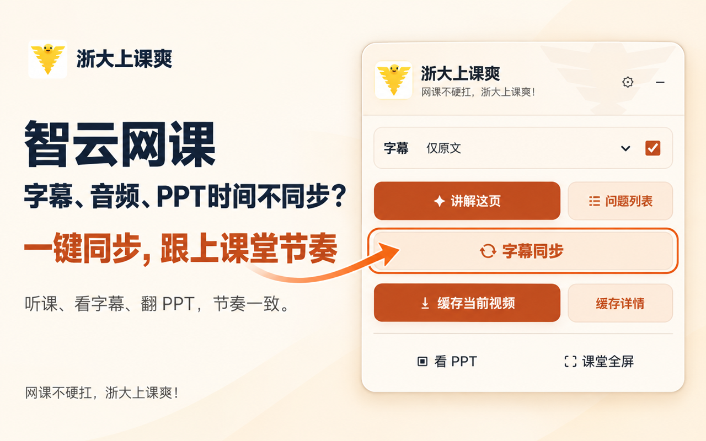
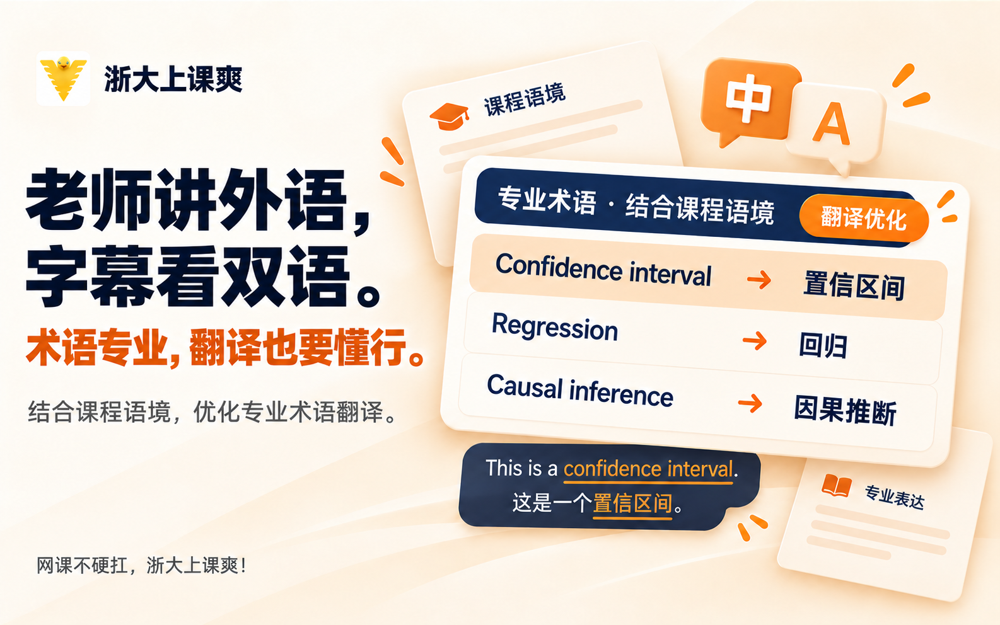
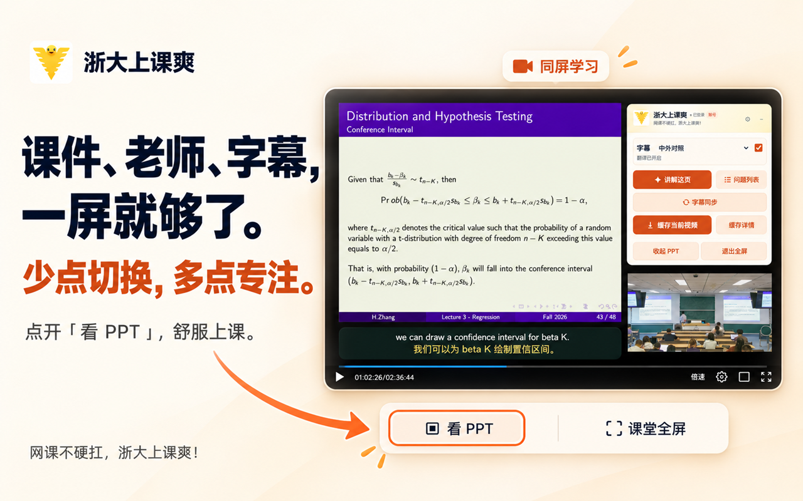
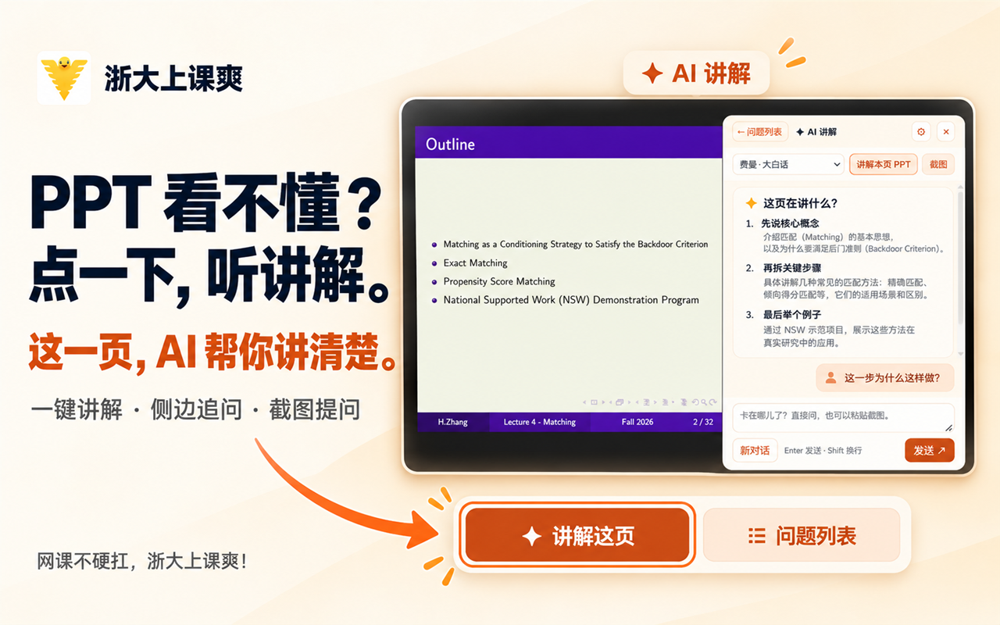
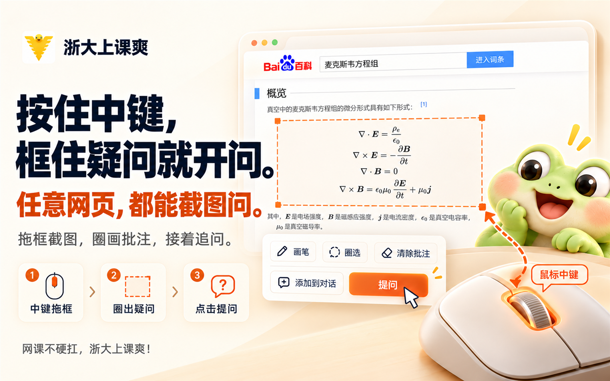
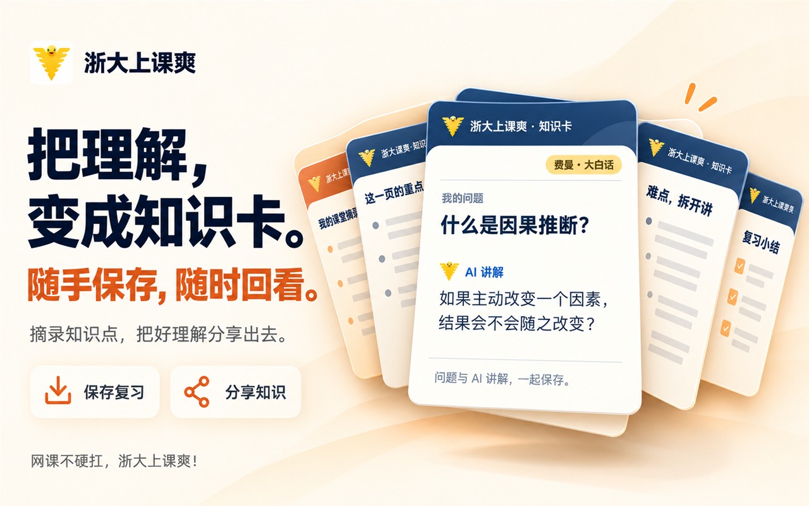

# 报告！浙大小奶蛙做了一个上课小工具，想请大家试试

大家好，我是一只刚入学的小奶蛙——**浙大小奶蛙。🐸**

入学以后，发现浙大有智云录课，我还挺开心：上课没跟上的地方，回来再听一遍；复习时忘掉的知识点，也有地方补。

直到真正打开视频。

高峰期，**加载圈转了又转**。好不容易播起来，字幕、声音和 PPT 又各有各的节奏。有时麦克风里的声音不太清楚，遇上双语课，更是听懂一句、漏掉半句。

再看 PPT——每个字都认识，连起来怎么就不认识了呢？

**本来是回来补课的，怎么先跟播放器较上劲了？**

于是，我和几个小伙伴敲敲打打，做了一个浏览器扩展：**浙大上课爽**。

想解决的都是看课时的小麻烦。下面，小奶蛙带你走一遍。

## 视频一直转圈？先缓存起来

准备复习之前，可以先点一下**「缓存当前视频」**，把准备看的内容缓存到本机。

尤其是已经知道今晚要看哪节课的时候，先做点准备，争取少遇到几次“刚跟上思路，视频又停了”。

缓存需要一点时间。小奶蛙也希望，下一次等待加载的时候，能把这点工夫提前安排好。

## 老师讲到下一页，字幕还在上一句？调一调

耳朵在听这一句，眼睛看到另一句，PPT 还停在上一页。三条线同时跑，小奶蛙实在有点忙不过来。

这时可以用**同步调节**，校准字幕和 PPT 的时间，让它们尽量跟上老师的声音。

如果还差一点，也可以继续微调。**把进度对齐，再把注意力交回课堂。**

## 双语课听着吃力？让专业词先变熟一点

双语课最让小蛙着急的，是上一句里的专业词还没想明白，老师已经开始讲下一句了。

打开**双语字幕和翻译**，就能对照原文与中文，再顺着课程内容理解专业表达。碰到不熟的词，也多了一个回头查清楚的抓手。

小蛙的母语虽然是“呱呱呱”，但也想慢慢听懂每一节课。🐸

## PPT、老师、字幕，放在一起看

一会儿找课件，一会儿看板书，一会儿又切回老师的画面。人还坐在椅子上，注意力已经在窗口之间蹦了几个来回。

打开**「看 PPT」**，把课件、老师画面和字幕放在同一屏，需要对照的时候，眼睛挪一挪就好。

小奶蛙终于不用来回蹦了，可以坐稳一点，接着听课。

## 这一页没看懂？请 AI 从这里讲起

有些 PPT 看起来只有几行，每一行却都藏着一个问号。

点一下**「讲解这页」**，让 AI 帮忙梳理当前页的概念和思路。讲完还没懂，也可以接着问：

> “这个概念是什么意思？”
> “这一步为什么要这样做？”
> “能不能举个简单的例子？”

**不用先把问题问得很专业。**从自己卡住的地方开始，哪一步没跟上，就多问一步。

## 问题说不清？直接框给它看

有时，没懂的地方就在眼前，一开口却只能说：“就是左边第二行，那个带符号的……”

这时候，可以**按住鼠标中键拖出选区**，框住那道公式、那张图，或者那段看了三遍还没懂的话。

再在图上圈一圈、画一画，把想问的位置标出来，交给 AI：

**“就是这里，小蛙没懂。”**

不用先把公式重新打一遍，也能把问题说明白。

## 终于弄懂了？给复习时的自己留张卡

今天看懂了，过几天再打开，却只记得：“我当时好像会来着。”

所以我们做了**知识卡**，把问题和讲解一起保存下来。下次复习，翻出来就能重新找回这段思路。

也可以把卡片分享给小伙伴：**这题，我会了！你看这里。🐸**

## 想请你来试试，也想听听哪里还不好用

**「浙大上课爽」已经在 Chrome 应用商店上线啦！**

为了邀请大家来体验，我们准备了**１个月免费试用**：试用期间全部功能开放，AI Token 也免费使用。

领走小助手，可以在 **Chrome 应用商店搜索「浙大上课爽」**。认准这个名字，就能找到我们。

**领取免费试用、反馈使用问题**，可以在抖音或小红书联系**「侃侃你的」**。

装好以后，先挑一节正在复习的课，试试同步、看 PPT，或者把那个一直没弄懂的地方框出来问一问。

哪里卡了，哪个按钮不好找，哪段讲解还是没说清楚，都欢迎告诉我们。小奶蛙和小伙伴们会认真看，再继续修修补补。

还有一份小惊喜：**本文评论区抽３位同学，每人送３个月会员！**

希望下次打开智云时，你能少一点看录课的抓狂，多一点——

**“哦，原来如此！”**

**网课不硬扛，浙大上课爽！🐸**
